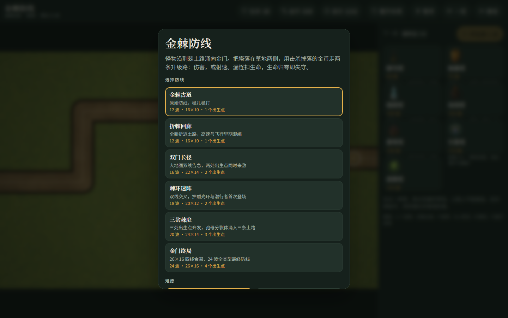
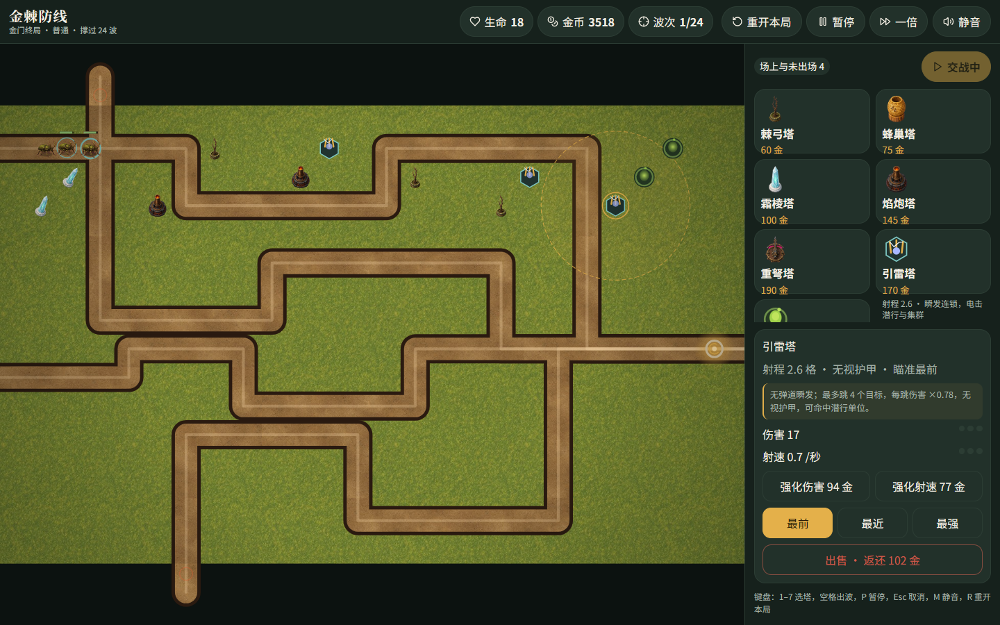

# 金棘防线 · Goldthorn Defense

一个纯前端塔防游戏：React + TypeScript + Canvas 2D。共 **6 个关卡、9 种敌方单位、7 种防御塔**，支持普通/困难难度、多出生点路径、按关卡存档，以及 Windows 双击启动。

- **技术栈**：Vite 8 / React 19 / TypeScript / Canvas 2D / Web Audio
- **运行形态**：本地 HTTP 服务，无后端、无数据库、无账号系统
- **存档**：`localStorage`，按关卡分别记录最佳通关波数与胜场





## 快速开始

**Windows（推荐）**：双击项目根目录的 `启动游戏.bat`。脚本会启动本地服务并自动打开浏览器，会留下一个黑色命令行窗口——**玩的时候不要关，关掉就等于停止服务**；再次双击不会重复起服务，只会再打开一次页面。

**手动启动**（需要 Node.js 22 或更高，本机 Node 24 实测可用）：

```bash
npm install
npm run dev
```

然后浏览器打开 `http://127.0.0.1:8080/`。

**不要双击 `index.html`**：这是 Vite + React 的 ESM 工程，必须走 HTTP 服务，`file://` 下模块加载会失败。若 8080 被占用，说明服务已在运行，直接刷新页面；本机设置了系统代理时，启动脚本已强制绕过本地地址的代理探测。

## 玩法与操作

选关卡 → 选「普通 / 困难」→「进入防线」→ 点右侧塔卡 → 点草地放塔 →「开始第 1 波」。点已建的塔可升级或出售（返还 60%）。初始 210 金、18 点生命，塔最高 3 级。对局中右上角有「重新开始本局」，可一键重置回准备阶段并保留当前关卡与难度。

| 操作 | 作用 |
| --- | --- |
| `1`–`7` | 按顺序选择 7 种防御塔 |
| `空格` | 准备阶段开下一波；菜单状态重开 |
| `Esc` | 取消当前放置 |
| `P` | 暂停 / 继续 |
| `M` | 静音切换 |
| `R` | 重开本局 |

菜单里的「敌情与克制」图鉴列出了每种敌人的机制与对应克制手段，卡关时先看这里。

## 内容一览

### 6 个关卡（波数逐关递增）

| 关卡 | 地图 | 出生路径 | 波数 | 特点 |
| --- | --- | --- | --- | --- |
| 金棘古道 | 16×10 | 1 | 12 | 原版防线，单路稳扎稳打 |
| 折棘回廊 | 16×10 | 1 | 12 | 折返土路，高速与飞行单位早期混编 |
| 双门长径 | 22×14 | 2 | 16 | 大地图双线告急，两处出生点同时来敌 |
| 棘环迷阵 | 20×12 | 2 | 18 | 双线交叉，护盾光环与潜行者首次登场 |
| 三岔棘庭 | 24×14 | 3 | 20 | 三处出生点齐发，孢母分裂体涌入 |
| 金门终局 | 26×16 | 4 | 24 | 四线合围，全类型最终防线 |

新增长关卡使用独立的 HP 曲线（0.09 / 0.08 / 0.07，旧关仍为 0.14），避免 24 波时敌人血量膨胀失控；多条路径按波次逐步开放，特殊敌人登场后移。每关最后一波都会出现全部 9 种敌人。

### 9 种敌方单位

| 单位 | 机制 | 应对 |
| --- | --- | --- |
| 棘甲虫 | 普通 | 常规射程与火力覆盖 |
| 疾行蜂 | 极快 | 霜棱减速拉长在火力网内的时间 |
| 重甲蟹 | 62% 护甲 | 重弩无视护甲，或腐藤破甲 |
| 暮蛾 | 飞行 | 高速，需提前覆盖 |
| 棘冠巨蟹 | 首领，980 HP | 集中集火 |
| 棘卫 | 为附近友军持续补护盾 | 腐藤酸蚀三倍溶解护盾，或重弩先点掉本体 |
| 影蛛 | 周期潜行，单体弹道无法锁定 | 引雷连锁、焰炮溅射；酸蚀挂上后潜行期间照样掉血 |
| 孢母 | 死亡分裂出 2 只高速孢子 | 把击杀点放在连锁或溅射覆盖范围内 |
| 孢子 | 分裂体，极快且不递归分裂 | 用连锁或溅射成片清理 |

### 7 种防御塔

| 防御塔 | 造价 | 射程 | 定位 |
| --- | --- | --- | --- |
| 棘弓塔 | 60 | 2.15 | 中程速射，清小怪 |
| 蜂巢塔 | 75 | 1.45 | 贴路高频连射 |
| 霜棱塔 | 100 | 2.35 | 减速，拉长敌人受击时间 |
| 焰炮塔 | 145 | 1.95 | 慢炮溅射，成片清理 |
| 重弩塔 | 190 | 3.25 | 超远射程、无视护甲、穿透 |
| 引雷塔 | 170 | 2.60 | 瞬发无弹道连锁，最多 4 跳、每跳 ×0.78，可命中潜行 |
| 腐藤塔 | 155 | 2.25 | 4.5 秒酸蚀（8/秒）、削 40% 护甲、对护盾三倍溶解 |

原有 5 种敌人与 5 种防御塔的基础数值未作任何改动；新增机制全部通过可选字段接入，不影响旧内容的行为。

**难度**：普通沿用原版全部数值（倍率全 1）；困难仅敌人生命 ×1.12、出怪间隔 ×0.92。

## 技术实现

- 模拟层 `src/game/sim.ts` 与渲染层 `src/game/render.ts` 分离，`tick(dt)` 驱动波次、移动、瞄准、命中、漏怪与胜负判定；`window.__goldthorn` 暴露直驱接口便于自动化验收。
- 路径由 `buildPoly()` / `samplePath()` 采样，多出生点地图通过 `paths[]` 与波次组的 `path` 字段分配。
- 新增单位与新塔用 Canvas 代码程序化绘制，闪电、护盾、潜行、酸蚀均有视觉反馈；音效由 Web Audio 实时合成，两套独立音色，无外部音频文件。
- 存档使用 `localStorage`，带 v1 → v2 记录迁移。
- 工程沿用 App Builder 平台脚手架，其中预置的登录 / 数据库代码在本项目未启用（`.grok/app-env.json` 中 `VITE_AUTH_ENABLED=false`）。**依赖包数量偏多，首次 `npm install` 较慢**，这是当前工程的主要成本。

## 目录结构

```text
.
├── README.md
├── docs/                       # 菜单与实机截图
├── public/art/                 # 原有塔与敌人的 PNG 素材
├── src/
│   ├── game/
│   │   ├── data.ts             # 单位 / 防御塔数值与波次定义
│   │   ├── levels.ts           # 6 关地图、路径与波次编排
│   │   ├── sim.ts              # 模拟层、机制判定、存档
│   │   ├── render.ts           # Canvas 绘制与特效
│   │   └── audio.ts            # Web Audio 合成音效
│   ├── components/
│   │   └── goldthorn.tsx       # UI、敌情图鉴、快捷键、检视面板
│   └── styles.css
├── scripts/                    # 构建脚本（含 Windows 启动修正）
├── 启动游戏.bat                # Windows 双击启动器
└── package.json
```

## 验证情况

使用真实 Chrome + Playwright 完成验收，非静态代码推断：

- `npm run typecheck` 通过。
- 机制单测 8 项全绿：护盾光环、酸蚀三倍溶解、破甲、潜行锁定差异、连锁跳跃衰减、分裂不递归、独立音效、重开归零。
- 真实金币约束下，普通难度 6 个关卡全部通关到 `won`；困难难度 11/12，唯一失手的旧关卡用已验证策略回归后 3/3 通关，确认旧关卡未被破坏。
- 每关最后一波运行时实测出现全部 9 种敌人；无卡死、无 `pageerror`、无资源 404。
- 菜单 / 商店 / 图鉴在桌面与移动视口下均无文字裁切或嵌套滚动。

## 已知限制

- 画布上下存在约 84px 黑边；右侧商店浮层会遮挡地图右端（不影响漏怪判定）。这两项为原版自带。
- 暮蛾的「飞行」目前只是渲染层浮动，模拟层仍沿土路移动。
- 离线或网络受限环境下，Google Fonts 与平台扩展脚本会加载失败并产生控制台报错，与游戏逻辑无关。
- 工程仍保留平台脚手架，未做依赖精简；如需上线部署，建议先剥离未使用的登录 / 数据库相关代码。

## 许可

本仓库未设置 `LICENSE` 文件。按 GitHub 默认规则，这意味着**保留所有权利**，他人不能合法地复用、修改或分发代码。若希望作为开源项目被使用，需另行添加许可证（如 MIT）。
